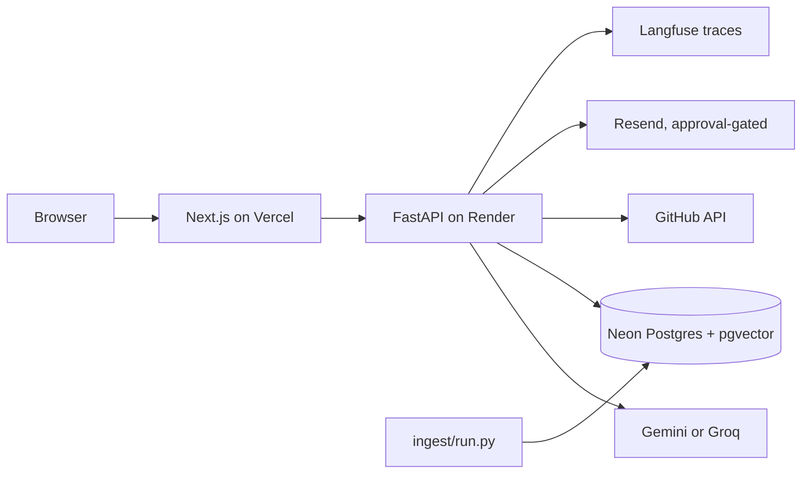

# Portfolio Chat

[](https://nextjs.org/)
[](https://react.dev/)
[](https://www.typescriptlang.org/)
[](https://tailwindcss.com/)
[](https://ui.shadcn.com/)
[](https://bun.sh/)
[](https://vercel.com/)
[](https://fastapi.tiangolo.com/)
[](https://www.python.org/)
[](https://docs.astral.sh/uv/)
[](https://www.docker.com/)
[](https://render.com/)
[](https://neon.tech/)
[](https://www.postgresql.org/)
[](https://github.com/pgvector/pgvector)
[](https://ai.google.dev/)
[](https://groq.com/)
[](https://langfuse.com/)
[](https://resend.com/)
[](https://pytest.org/)
[](https://github.com/features/actions)

A chat-first portfolio. Visitors ask questions about my experience and work in
plain language and get answers generated from a private corpus of career notes,
with citations back to the source files. The agent can also call tools: live
GitHub repository data, and a contact form whose messages I approve before
anything is sent.

Live site: https://manas-dev.vercel.app/
API: https://portfolio-api-59on.onrender.com

## What this demonstrates

- Retrieval-augmented answers with citations, plus an honest "I do not have
  that on record" refusal when nothing matches.
- A provider-agnostic LLM layer: Gemini primary, Groq fallback, one small
  `LLMClient` interface, no LangChain.
- Native tool calling behind a registry that is the security boundary.
- Approval-gated email: the model can only draft; sending needs a one-time
  token, an IP match, and an unexpired row.
- Hybrid retrieval (lexical plus dense, fused with reciprocal rank fusion)
  instead of dense-only search.
- Production concerns on free tiers: rate limits, IP hashing, CORS, health
  checks that do not touch the database, and migrations in the image CMD.

## How a chat request flows

1. The terminal-style UI streams a POST to the FastAPI `/chat` endpoint.
2. A rate limiter checks the caller's IP hash against per-minute and per-day
   caps.
3. Retrieval runs a hybrid search over corpus chunks (lexical plus dense
   embeddings, fused with reciprocal rank fusion). If nothing relevant is
   found, the agent is told so, and it answers "I don't have that on record"
   instead of inventing.
4. `LLMClient` sends the question, retrieved context, and tool declarations to
   the model. Tool calls dispatch through `app/tools/registry.py`, the only
   boundary the model can reach. Tools return errors as data, never as raised
   exceptions, so a failure never breaks the answer mid-stream.
5. The reply streams to the browser as server-sent events with inline citation
   labels.
6. If the visitor wants to send a contact message, the model may only draft it:
   a `pending` row appears, the UI shows an Approve button, and the browser
   itself calls `POST /messages/{id}/send` with a one-time approval token
   bound to the originating IP and an expiry. The model never sees the token and
   has no send tool.

## Tech stack

Frontend: Next.js (App Router), TypeScript, Tailwind CSS, shadcn/ui, Bun, Vercel.

Backend: FastAPI, Python, uv, Docker, Render.

Data and AI: Neon Postgres, pgvector, Gemini, Groq, Langfuse, Resend, MCP
(planned showcase), pytest, GitHub Actions.

## System architecture



The full service map with all 20 boxes is in [docs/architecture.md](docs/architecture.md).

## Integrations

### With my other projects

| Project | What it is | Relation to this portfolio |
| --- | --- | --- |
| [SyntaxAndSorcery](https://github.com/manaskumar1704/SyntaxAndSorcery) | Interactive arcade that teaches engineering concepts through small games | Listed as a project; reachable through the GitHub tool for live repo data |
| [opencode-toolkit](https://github.com/manaskumar1704/opencode-toolkit) | TypeScript CLI and TUI for agent config, AST security scanning, and skill routing | Shares the tool-calling and MCP mindset; Portfolio's own planned MCP server will import `apps/api` tools instead of copying them |
| [ChainForge2.0](https://github.com/manaskumar1704/ChainForge2.0) | Public TypeScript project | Listed as another project under the same owner |
| JobFinder (companion service) | Multi-service JD parser, matcher, and Typst resume engine | Idle connector: typed seam with a mocked implementation; live HTTP only when its contract and auth arrive |
| ThirdBrain (companion service) | Hybrid GraphRAG workspace with a 3D citation canvas | Idle connector: typed seam with a mocked implementation; live HTTP only when its contract and auth arrive |

The companion services are not in this repository. The portfolio runs standalone
on its local Markdown and pgvector corpus by default. Connectors to them are
idle typed seams with mocked implementations; live HTTP is added only when a
real contract and auth arrive.

### External services

- GitHub API: live repository data, allowlisted to `GITHUB_OWNER`.
- Resend: sends email only after the approval route succeeds.
- Langfuse: optional tracing, activated by environment variables, a no-op
  without them.
- Neon: Postgres with pgvector; pooled URL at runtime, direct URL for Alembic.
- Render: hosts the API image; Vercel hosts the frontend.

### MCP

Planned showcase layer: an `mcp/` server will import tool handlers from
`apps/api` and expose the same registry to any MCP client. It does not exist
yet, and it will never copy the handlers.

## Repository structure

```text
apps/web        Next.js frontend (Vercel)
  src/components/ui   dumb reusable primitives
  src/features/<name> feature components and hooks
  src/lib/api         data access layer (typed fixtures until the API is set)
apps/api        FastAPI backend (Render)
  app/core            config, logging, tracing, rate limit, guardrails
  app/api             routers only, no business logic
  app/services        capabilities as plain functions (rag, github, contact, llm)
  app/tools           thin wrappers exposed to the model, plus the registry
  app/db, app/schemas pool, models, queries; Pydantic requests/responses
  ingest              corpus -> chunk -> embed -> upsert (batch, not served)
corpus          fixtures live here; the real corpus is a separate private repo
  _test         fictional fixture files for retrieval tests, labelled
  _source       PDFs (git-ignored); convert with ingest/from_pdf.py
evals           golden sets for retrieval, live answers, groundedness
mcp/            (planned) MCP server, will import tools from apps/api
design/         design reference export, read-only
docs/           decisions (ADRs), plans, deploy steps, retros
scripts/        dev tooling: graphify pipeline, preflight.sh, retro digest
```

## Running the API locally

Needs Python 3.12 or 3.13 with uv, and any reachable Postgres (a local server,
or a Neon dev branch).

```bash
cd apps/api
uv sync
cp .env.example .env          # the file documents every variable
uv run alembic upgrade head   # migrations use SYNC_DATABASE_URL (direct host)
uv run python -m ingest.fixtures   # load the fixture corpus for development
uv run uvicorn app.main:app --reload
```

Then:

```bash
curl http://localhost:8000/health   # liveness, does not touch the database
curl http://localhost:8000/ready    # readiness, exercises the database
```

In `.env`, `REQUIRED` means production boot refuses to start without it. The
minimum set for a working dev chat: `DATABASE_URL` (pooled host),
`SYNC_DATABASE_URL` (direct host), `GEMINI_API_KEY`, `GITHUB_OWNER` (plus
`GITHUB_TOKEN`), and `IP_HASH_SALT` (any 16+ characters locally). `APP_ENV`
stays `local`; only `production` turns on the fail-fast boot checks.

## Running the frontend locally

```bash
cd apps/web
bun install
cp .env.example .env.local    # or leave it unset entirely
bun run dev                   # http://localhost:3000
```

With no `NEXT_PUBLIC_API_URL` set, the UI runs on typed fixtures, so a fresh
checkout works with no backend running. The variable must be the literal
`process.env.NEXT_PUBLIC_API_URL` read in one file (`src/lib/api/config.ts`)
because Next inlines it at build time.

## The corpus

- The real career corpus is a separate private repository, referenced by
  `--dir` at ingest time. It is never committed here.
- `corpus/_test/` holds fictional fixtures, labelled as such on every file.
  They exist so retrieval tests have concrete assertions. Never ingest them
  into production.
- `corpus/_source/` holds PDFs and is git-ignored. Convert with
  `python -m ingest.from_pdf`; commit the Markdown, never the PDF. The
  converter checks that heading structure and hyphenation survived, and exits
  non-zero rather than writing a file that would retrieve badly.
- Heading levels are load-bearing: `#` and `##` are chunk boundaries and
  become citation labels.
- Ingest skips underscore-prefixed directories and `README`/`INDEX` prose.

Ingest a corpus directory (run from `apps/api`):

```bash
uv run python -m ingest.run --dir <markdown-dir> --prune
```

## Tools and what the model may do

- The registry in `app/tools/registry.py` is the security boundary. A handler
  outside it does not exist, as far as the model is concerned.
- Tool arguments are validated by Pydantic models, and the JSON Schema sent to
  the provider is tested to agree with them.
- Tools return errors as data, so the visible answer degrades gracefully.
- `get_github_repo` is allowlisted to `GITHUB_OWNER`, matched as a full
  `owner/repo` string. Raw URLs are normalised first.
- Email is never a tool. The model may call `draft_message`, which writes a
  pending row. Sending is a plain HTTP route needing token match, IP match,
  and an unexpired row.

## Tests and evals

```bash
cd apps/api && uv run pytest             # unit and contract tests
uv run --project apps/api pytest evals -m "not slow"   # retrieval + answers (from repo root)
cd apps/web && bun run lint && bun test  # frontend
```

The evals are the site's claims in testable form: retrieval must find the
right file for on-topic questions and nothing for off-topic ones; live answers
are graded on substring facts, citation membership, refusal markers; the slow
groundedness harness downloads an NLI model once. Details and cost table live
in `evals/README.md`.

## Deployment

- API on Render: built from `render.yaml` (blueprint). Deploy starts only
  after CI is green (`autoDeployTrigger: checksPass`). Free tier has no
  `preDeployCommand`, so migrations live in the image's own CMD, shell-wrapped
  with `sh -c`.
- Frontend on Vercel: deploys on every push. Changing
  `NEXT_PUBLIC_API_URL` on the dashboard triggers a rebuild that ships the
  new value; a plain redeploy would keep the old baked-in one.
- CI on GitHub Actions: three gates (api, web, evals) on push and pull requests.
- UptimeRobot (external monitor): pings `/health`. Monitors default to HEAD,
  and health endpoints explicitly answer HEAD.
- Keep-alive cron: throttled by GitHub's free plan; it supports the external
  monitor, never replaces it.
- Neon: the runtime uses the pooled URL, Alembic uses the direct URL.
  Password resets are branch-scoped: reset the production branch's
  `neondb_owner`, not the branch your local `.env` points at.

The full step-by-step live in `docs/DEPLOY.md`. Operational rules learned the
hard way are collected in `.agents/skills/free-tier-deploy/SKILL.md`.

## Documents

- `docs/decisions/` - eleven numbered ADRs plus the ponytail audit record.
- `docs/DEPLOY.md` - the deploy runbook, executed end to end in October 2026.
- `docs/architecture.md`, `docs/feature-plan.md`, `docs/frontend-plan.md`.
- `docs/retro-oct2026.md` - what the session history says about how this was
  built, which loops were hit, and which lessons became skills or scripts.
- `AGENTS.md` - the working contract for AI agents, including the locked
  stack and the corpus rules.
- `.agents/skills/` - author-authored skills (shell discipline, free-tier
  deploy) plus vendored ones pinned by `skills-lock.json`.

## Operational notes

The condensed version of what deployment and October actually taught:

- Verification order after every deploy: `curl /health`, then `/ready`, then
  one real tool call through `/chat`, then the browser.
- A failed boot keeps the previous image serving. If code lands but behaviour
  does not change, read the deploy log, not the check runs.
- Trust nothing about proxy IPs from memory: fill `TRUSTED_PROXY_CIDRS` from
  a temporary probe route, then delete the route.
- One mid-chat `OperationalError` from a dangling connection is usually a Neon
  compute waking from its five-minute idle sleep, not a code failure.
- Embeddings stay local and ONNX so the 512 MB container tier survives, and
  the model is baked into the Docker image at build time; a cold start never
  waits on a download.
- Never commit secrets. `.env` is git-ignored; `.env.example` is the template
  and the documentation.