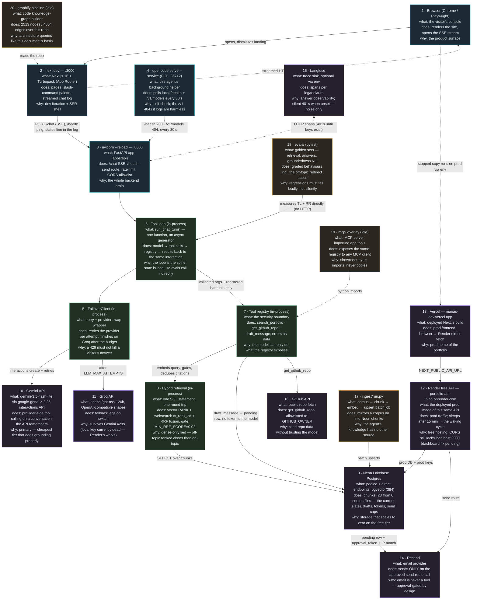

# Architecture

The system as it currently runs, with the live processes and every action the
agent can take. One line per box: what it is, what it does, why it exists. The
quick request-flow narrative lives in the README; this page is the map.

## Known gaps (as of 2026-10-23)

- **Corpus slate**: the ingested corpus is `corpus/local/` = 6 documents / 23
  chunks. Missing standalone `skills.md`, `resume.md`, and `contact.md` means
  `/skills`-shaped prompts depend entirely on the profile doc's overlap and
  can honestly miss — the `/skills` diagnosis (2026-10-22) ended there, not in
  a bug. Real documents come from the owner; `_test/` fixtures are never
  ingested.
- **Recall ceiling**: `MIN_RRF_SCORE = 0.02` requires both retrievers to
  agree (decision 0004). Compound queries whose words the corpus does not
  carry starve the lexical leg and score at most 0.0164 before the gate —
  the agent's tool description now nudges it to retry shorter instead of
  widening the gate; recalibration lives in `evals/` on the real corpus.
- **Render CORS**: the production instance still lacks
  `http://localhost:3000` in `CORS_ORIGINS`, so the local browser against the
  live API is a Vercel-only story until the dashboard value is updated.
- **Langfuse**: unset locally, so the OTLP exporter retries and logs 401s —
  noise, no functional impact.
